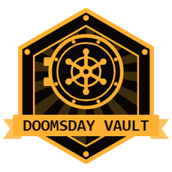

# Doomsday Vault for Home Assistant

A Home Assistant app (formerly called an add-on) for your preparedness, in the
side panel:

- **Library**: an offline survival library on your own disk (Wikipedia, medical
  references, repair guides, farming, preparedness manuals, a North America
  map) with search across all of it.
- **Inventory**: food, water, medical supplies and equipment, sorted by
  category, with expiration dates and photos.
- **Armory**: weapons, ammunition and accessories, synced with WeaponLog and
  usable even when WeaponLog is not reachable.

## Install

1. In Home Assistant, go to **Settings → Apps → Install app**.
2. Open the menu in the top right, select **Repositories**, add
   `https://github.com/Nuvolares/ha-doomsday-vault` and select **Add**.
3. Install **Doomsday Vault**, start it and open it from the side panel.

The image is built on your device the first time, which takes a few minutes.

## Test a local copy

1. Install the **Samba share** or **Terminal & SSH** app.
2. Copy the `doomsday_vault` folder into the `local_apps` folder (called
   `addons` on older installations).
3. In the app store, open the top-right menu and select **Check for updates**.
   The app appears under **Local apps**.
4. After changing files, select **Check for updates** again and then
   **Rebuild** on the app page.

See [doomsday_vault/DOCS.md](doomsday_vault/DOCS.md) for usage and options.

## How it works

- `kiwix-serve` serves the ZIM archives. The app proxies it through Home Assistant Ingress.
- A Python (aiohttp) service manages sources, downloads, the update schedule, search, the
  inventory and the WeaponLog sync.
- Library content is stored in `/media/doomsday_vault`. The inventory, the Armory copy and the
  app state live in `/data` (included in Home Assistant backups). The source list is in the
  app's config folder.

## License

MIT, see [LICENSE](LICENSE). Downloaded content keeps its own license, listed in DOCS.md.
